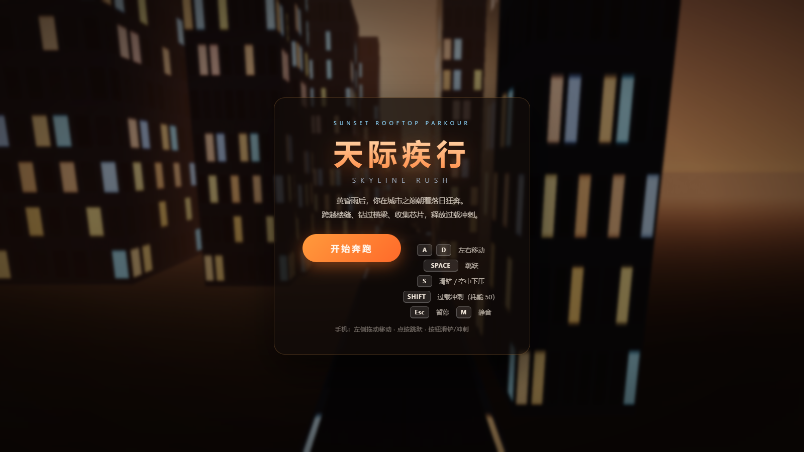
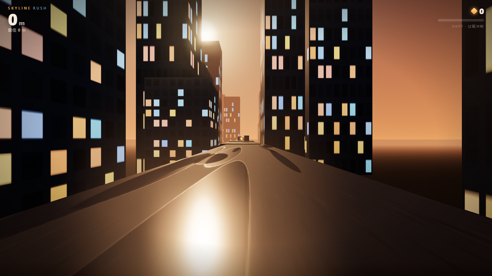

<div align="center">

<h1>🌆 天际疾行 · Skyline Rush</h1>

<h3>在黄昏的摩天楼顶，朝着落日狂奔。<br/><sub>Rooftop parkour, straight into the sunset.</sub></h3>

<p>
  
  
  
  
</p>

<p>
  <b>中文</b> ｜ <a href="#en">English</a>
</p>

</div>

<p align="center">
  
  
</p>

---

## 🏃 这是什么？

雨刚停，天快黑了。你站在城市最高的天台上，面前是一整片悬在黄昏里的摩天楼群。

**《天际疾行》是一款第一人称 3D 天台跑酷游戏**：你沿着天台一路向前狂奔，跨越楼与楼之间的缝隙、滑铲钻过设备横梁、躲开通风机组和天线墙，顺手收集散落的金色数据芯片——攒满能量就能释放**过载冲刺**，撞碎眼前的一切。

- **世界是流式生成的**：楼群、天台、障碍、芯片全部按种子程序化生成，每一局都是一座新城。
- **难度会追着你跑**：速度从 12 m/s 一路涨到 34 m/s，缺口越来越宽、平台越来越窄、障碍越来越密。
- **死了就重来**：距离就是分数，最佳成绩存在本地。

> 和姊妹作 [《星屑旅人 · Stardust Drifter》](https://github.com/zzuli-ljz/stardust-drifter) 完全不同：那一个是绕着星球跑的第三人称收集冒险，这一个是一条道跑到黑（准确地说是跑到日落）的第一人称速度游戏。

## 🎮 操作

| 操作 | 按键 |
| --- | --- |
| 左右移动 | `A` `D` / 方向键 |
| 跳跃 | `空格` |
| 滑铲 / 空中下压 | `S` / `Ctrl` / `↓` |
| 过载冲刺（耗能 50） | `Shift` |
| 暂停 / 静音 | `Esc` / `M` |

手机等触屏设备：**左右滑动**转向、**上滑/轻点**跳跃、**下拉按住**滑铲、右下角**冲刺**按钮（就绪时发光）；支持一键全屏。

**小技巧：**
- 空中按滑铲会**急速下坠**，可以用来精准落上矮平台；
- 有土狼时间和跳跃缓冲，边缘起跳很宽容；
- 过载冲刺期间**无敌 + 滑翔**：自动升到楼顶上方的巡航高度平飞过缺口，空中按空格还能再拔高；冲刺结束时若仍悬在缺口上方，会进入 2 秒缓降、自动落到下一块楼顶——缓降中按 `S`/`↓`（手机下拉）可以随时主动收伞落地——坠落边缘按下 Shift 就是你的保命符。

## ⚙️ 渲染（这次往"真实"堆了料）

- **PBR 材质 + IBL 环境光照**：用程序化黄昏天空生成 PMREM 环境贴图，雨后天台的积水会真实反射天空的颜色；
- **实时软阴影**：PCFSoft 阴影贴图跟随玩家移动，障碍物在夕阳下拉出长影；
- **程序化天空**：自定义 shader 绘制天顶→地平线的色带、太阳盘面与两层光晕；
- **竞速模式**：2200 米固定赛道、三人同跑（你 + 两个幽灵对手），撞障碍/掉下楼只扣速度不清零，实时名次表 + 3-2-1 起跑倒计时，第一个冲过终点线获胜；
- **日光推进**：每跑 400 米，太阳压低一档、雾色转深——黄昏 → 落日贴地 → 紫红余晖 → 1200 米后的蓝调霓虹，窗光渐亮、辉光渐强，全程只改视觉不碰物理；
- **GPU 雨丝**：520 条雨全部在顶点着色器里下落（零 CPU 开销），随镜头移动循环；
- **后期管线**：UnrealBloom 辉光 + ACES Filmic 色调映射 + 暗角/颗粒/过载速度线；
- **指数雾**：远景楼群沉进暮色里，只留亮着的窗；
- **克制的信息设计**：芯片是"暗色电路板 + 发光线路"，障碍物贴 3M 式反光条——该看见的一定看得见，但绝不糊屏刺眼。

## 🧱 其他技术点

- **流式世界**：天台段按需生成、过期回收，楼群用单个 `InstancedMesh`（460 实例）渲染，芯片也是实例化的——整座城市只有个位数的 Draw Call；
- **浮点原点回正**：跑远后整体平移世界坐标，理论上可以无限跑下去；
- **手感细节**：土狼时间、跳跃缓冲、落地镜头下沉、横移镜头倾斜、随速度变化的 FOV 与风声；
- **全程序化音频**：风声、脚步、滑铲、跳跃、芯片音阶（连击升调）、坠楼、过载——全部 WebAudio 实时合成，仓库里没有音频文件；
- **自适应画质**：帧率不足自动降分辨率、关辉光、降阴影精度。

## 🧪 自动化冒烟测试

带一个基于 **Chrome DevTools 协议** 的端到端测试，里面的自动跑酷 AI 会真的"看路"：遇缺口起跳、对横梁滑铲、绕开天线墙。测试覆盖：开局奔跑、距离增长、强制死亡→结算、重开，并全程收集 JS 异常。

```bash
# 在本目录起服务器后：
node tools/cdp-test.mjs
```

当前状态：**全流程通过，0 JS 错误。**

## 🚀 运行

双击 `index.html` 即可（无需服务器、无需联网）。

开发：

```bash
npm install     # three + esbuild
npm run build   # 重新打包 assets/game.js
npm test        # CDP 冒烟测试（需先起本地服务器）
```

调试参数：`?auto` 直接开局；`?sim` 自动跑酷 AI 演示。

## 📁 项目结构

```
index.html            入口（双击即玩）
assets/game.js        打包产物（已内联 Three.js）
src/
  main.js             状态机、主循环、难度曲线、自动跑酷 AI
  scene.js            渲染器、天空 shader、雨丝、阴影、后期
  city.js             程序化楼群 / 天台 / 障碍 / 芯片（流式生成）
  player.js           第一人称控制器与物理
  fx.js               粒子池
  audio.js            WebAudio 程序化音效
  hud.js / input.js   界面与输入（键鼠 + 触屏）
tools/cdp-test.mjs    CDP 端到端冒烟测试
```

---

<a id="en"></a>

# 🌆 Skyline Rush

### Rooftop parkour, straight into the sunset.

The rain just stopped. You're on the tallest rooftop in the city, and ahead of you: an endless skyline floating in dusk.

**Skyline Rush is a first-person 3D parkour runner.** Sprint across rooftops, leap the gaps between buildings, slide under gantry beams, dodge vents and antenna walls — and grab golden data chips to fuel an **Overdrive dash** that smashes through everything in your way.

- The world is streamed and seed-generated: every run is a new city.
- Speed ramps from 12 to 34 m/s. Gaps widen. Rooftops narrow. Obstacles multiply.
- Distance is your score; your best run is saved locally.

> Totally different from its sibling [*Stardust Drifter*](https://github.com/zzuli-ljz/stardust-drifter) — that one is a third-person spherical-gravity collect-a-thon; this one is a first-person speed game that ends only when you fall.

## 🎮 Controls

| Action | Key |
| --- | --- |
| Move | `A` `D` / arrows |
| Jump | `Space` |
| Slide / air-slam | `S` / `Ctrl` / `↓` |
| Overdrive (50 energy) | `Shift` |
| Pause / Mute | `Esc` / `M` |

Touch devices: slide left/right to steer, swipe up (or tap) to jump, drag down and hold to slide, and a dash button bottom-right (glows when ready). Fullscreen supported.

**Tips:** pressing slide mid-air slams you down for precise landings; coyote time + jump buffering make edge jumps forgiving; Overdrive makes you invincible **and lets you glide** — it lifts you to a cruise altitude above the rooftops so gaps can't kill you mid-dash (tap Space to climb higher). When the dash ends over a gap, a 2-second soft-landing glide takes over and drops you safely onto the next rooftop — press `S`/`↓` (or drag down on touch) to cut the glide and land whenever you want.

## ⚙️ Rendering

- **PBR + IBL**: a PMREM environment map generated from the procedural dusk sky, so wet rooftops genuinely reflect the horizon;
- **PCFSoft real-time shadows** that follow the player, with long sunset shadows from obstacles;
- A custom sky shader (zenith-to-horizon gradient, sun disc, dual glow);
- **Race mode**: a 2200 m fixed track raced by three runners (you + two ghost rivals) — crashing or falling costs speed instead of the run, with a live leaderboard, a 3-2-1 countdown and a finish line;
- **Daylight progression**: every 400 m the sun drops another notch and the palette deepens — golden hour → sun-on-the-horizon → magenta afterglow → blue-hour neon past 1200 m, with windows brightening and bloom swelling. Pure visuals, physics untouched;
- **520 GPU rain streaks** falling entirely in the vertex shader;
- UnrealBloom + ACES Filmic tone mapping + vignette/grain/overdrive speed-lines;
- Exponential fog that sinks the far skyline into dusk;
- **Restrained readability**: chips are dark circuit boards with only their traces lit, obstacles wear 3M-style reflective tape — everything you must see is visible, nothing blooms over your view.

## 🧱 Engineering notes

- Streamed world with pooled platforms/obstacles; all buildings in a single 460-instance `InstancedMesh`; the whole city renders in a handful of draw calls;
- Floating-origin rebasing — you can run forever;
- Coyote time, jump buffering, landing camera dip, strafe roll, speed-based FOV and wind;
- Fully procedural WebAudio (wind, footsteps, slides, combo-pitched chimes, falls, overdrive) — zero audio files;
- Adaptive quality: resolution, bloom and shadow resolution scale down under load.

## 🧪 Smoke test

A CDP-based end-to-end test drives a real browser with an autopilot AI that actually reads the world ahead: jumps gaps, slides under beams, dodges walls — asserting distance growth, death → game over → retry, and collecting JS exceptions along the way. Status: **all passing, 0 JS errors.**

## 🚀 Run it

Double-click `index.html`. For development: `npm install && npm run build && npm test`.

Debug flags: `?auto` starts instantly, `?sim` lets the autopilot AI demo the game.

<div align="center">
<br/>
<sub>Made with Three.js, procedural everything, and a fear of heights.</sub>
</div>
